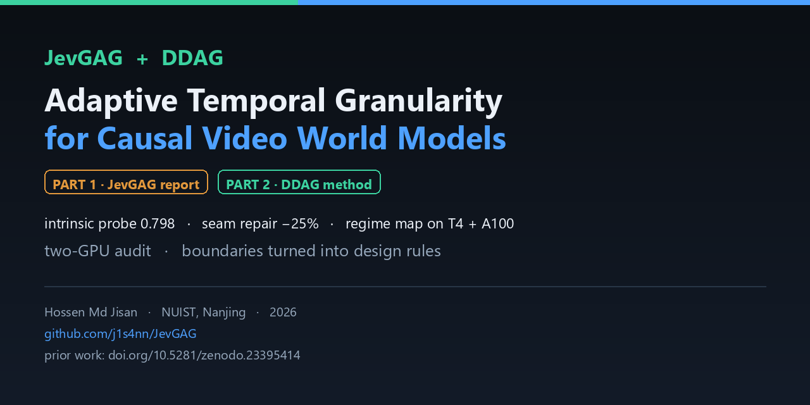
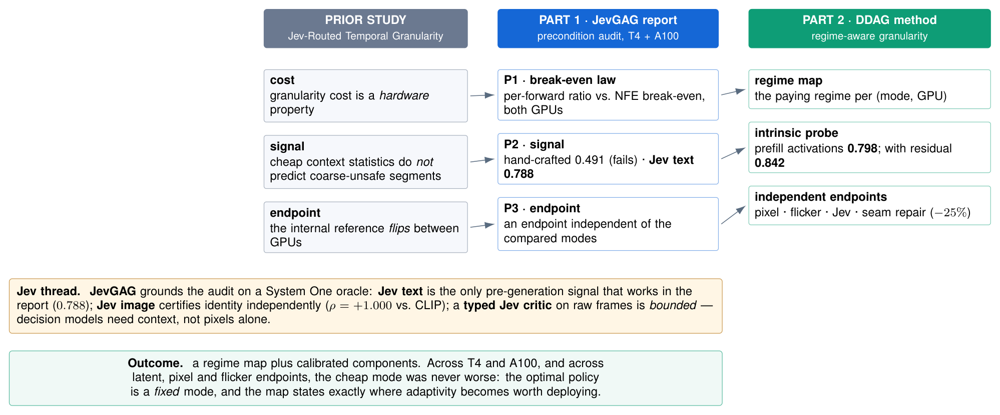
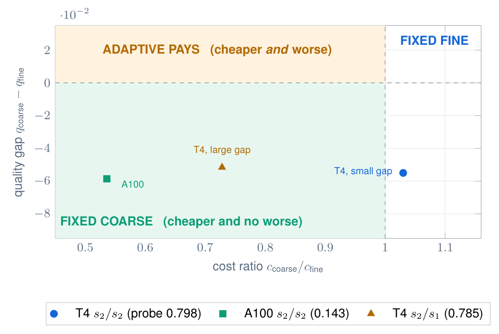

# JevGAG · DDAG — Regime-Aware Adaptive Temporal Granularity for Causal Video World Models



[](LICENSE)
[](https://www.python.org/)
[](https://j1s4nn.github.io/JevGAG/)
[](DATA.md)
[](jevgag/results/e9_audit/)
[](#hardware)
[](https://doi.org/10.5281/zenodo.23693517)
[](https://doi.org/10.5281/zenodo.23395414)

A two-part research programme on **adaptive temporal granularity** for **causal video generation** and
**interactive video world models**: when should a generator spend fine per-frame compute, and when is a
cheaper chunked mode enough?

> **Keywords:** causal video generation · video world models · autoregressive diffusion · adaptive compute
> · temporal granularity · efficient inference · regime map · boundary analysis · System One / Jev.

---

## Contents

- [The paper](#the-paper) · [Prior work](#prior-work) · [The programme in one figure](#the-programme-in-one-figure)
- [Part 1 · JevGAG — the report](#part-1--jevgag--the-report)
- [Part 2 · DDAG — the method](#part-2--ddag--the-method)
- [Full results](#full-results) · [Datasets (public)](#datasets-public) · [Figures and videos](#figures-and-videos)
- [Achieved · boundary · open](#achieved--boundary--open) · [Repository layout](#repository-layout)
- [Hardware](#hardware) · [Reproduce](#reproduce) · [Citation](#citation)

---

## The paper

> **Regime-Aware Temporal Granularity for Causal Video World Models: When Does Adaptivity Pay?**
> **Md Jisan Hossen** (Department of Artificial Intelligence, NUIST, Nanjing, China).
> Preprint, 2026. **https://doi.org/10.5281/zenodo.23693517**

Causal video generators produce a rollout one temporal chunk at a time, so spending expensive per-frame
compute only on hard segments looks attractive. We show that this idea rests on three **preconditions** —
cost, signal and endpoint — and that all three are **regime properties** rather than universal facts. On a
matched two-GPU study (**Tesla T4** and **A100-80GB**) of a causal diffusion backbone we (i) measure the
per-forward cost against the schedule break-even and find the *same* mode pair on **opposite sides** of the
inequality; (ii) show that hand-crafted context statistics cannot predict coarse-unsafe segments (AUROC
**0.491**), that an **intrinsic** probe on the generator's own prefill activations reaches **0.798** on one
GPU and **inverts** to **0.143** on the other, and that only a **multi-feature** model over the probe and a
sampler convergence residual transfers across both (**0.842** and **0.833**); and (iii) show that an endpoint
independent of the compared modes is mandatory. We then derive a **regime map** that states exactly when
adaptivity pays — only when the cheap mode is **cheaper *and* worse** — and find our operating points fall
outside that region: the coarse mode was never worse in quality, so under the stated objective the optimal
policy is a **fixed** mode and a router is unnecessary.

**Contributions**

- **A two-GPU regime map** partitioning the (cost-ratio, quality-gap) plane into three policies — fixed
  fine, fixed coarse and adaptive — with the adaptive region defined by a conjunction: the cheap mode must
  be **cheaper *and* worse**.
- **An intrinsic signal — and the limit of single signals.** A probe on the generator's own prefill
  activations predicts coarse-unsafe segments at **0.798** AUROC with no external oracle (vs **0.491** for
  hand-crafted context statistics); it **inverts** on the second GPU (**0.143**), and only a **multi-feature**
  model over the probe and a **convergence residual** transfers across both GPUs (**0.842** / **0.833**).
- **A training-free seam repair.** A 25 % latent blend reduces the switch-boundary discontinuity by **25 %**
  *and* improves fidelity, with no training.
- **A boundary analysis.** Signals are regime properties; drift is linear and policy-insensitive; and a
  decision-model critic shown only pixels is at chance. Each boundary is stated with the experiment that
  produced it.

**Links:** paper [`doi.org/10.5281/zenodo.23693517`](https://doi.org/10.5281/zenodo.23693517) ·
figures [`assets/figures/`](assets/figures/) · website [j1s4nn.github.io/JevGAG](https://j1s4nn.github.io/JevGAG/).

---

## Prior work

This programme builds directly on the earlier study

> **Md Jisan Hossen**, *Jev-Routed Temporal Granularity with Recovery and Hysteresis for Causal Video
> Generation*, preprint, 2026. **https://doi.org/10.5281/zenodo.23395414**

That study framed adaptive granularity as resting on **three preconditions** (cost, signal, endpoint) and
found the trade-off to be *conditional*. This repository **audits those preconditions** (Part 1) and then
**turns them into a deployable rule** (Part 2).

---

## The programme in one figure



*One row per precondition: the boundary found in the earlier study, the audit that measures it, and the
component that resolves it. The Jev thread is highlighted — Jev grounds the audit.*

---

## Part 1 · JevGAG — the report

A measured audit of the four preconditions on **two GPUs**, with a matched design, an independent
endpoint protocol, and a claim-to-artifact audit (**18/18 PASS**).

| Precondition | What the report measures |
|---|---|
| **cost** | the per-forward ratio against the NFE break-even — the same mode pair sits on **opposite sides** of the inequality on T4 and A100 |
| **signal** | hand-crafted context statistics reach only **0.491** AUROC, while an off-device **Jev** text oracle reaches **0.788** — but an **image**-grounded one is *worse* (**0.667**) |
| **endpoint** | the internal reference **flips** between GPUs, so an independent endpoint is mandatory — the image-grounded Jev endpoint agrees with CLIP subject consistency at **ρ = +1.000** |
| **calibration** | confidence gating is **neutral** (\|Δ\| ≤ 0.0013 at every budget) |

Also established: a two-threshold controller with **hysteresis + forced recovery** stabilises switching,
and a measurable **seam** appears at every switch boundary.

→ **Read the report:** [`jevgag/report/REPORT.md`](jevgag/report/REPORT.md) (GitHub-readable) ·
[PDF](jevgag/report/main.pdf) · code and audited results: [`jevgag/`](jevgag/) ·
figures: [`jevgag/figures/`](jevgag/figures/)

---

## Part 2 · DDAG — the method

**D**eadline- and **D**rift-**A**ware **G**ranularity turns the preconditions into a **regime map** and a
set of calibrated components, each validated by its own experiment.

| Component | Question | Outcome |
|---|---|---|
| **intrinsic probe** | can the generator predict its own granularity safety? | **0.798 AUROC** from its own prefill activations — no external oracle |
| **convergence residual** | does sampler convergence verify safety? | **0.760** on T4; **probe + residual = 0.842** — the strongest signal in the programme |
| **seam repair** | can the switch seam be reduced without training? | a **25% latent blend cuts the seam 25%** and improves fidelity |
| **regime map** | where does adaptivity actually pay? | it pays only when the cheap mode is **cheaper *and* worse** |



→ Method, twelve numbered experiments and results: [`ddag/`](ddag/)

---

## Full results

Everything below is re-derivable from the public result files (see [Datasets](#datasets-public)).
Confidence intervals are prompt-grouped bootstrap (2{,}000–4{,}000 resamples); AUROCs use
leave-one-prompt-out cross-validation grouped by prompt.

### R1 · Signals for coarse-unsafe segments (direct AUROC)

| signal | Tesla T4 | A100-80GB | notes |
|---|---|---|---|
| chance | 0.500 | 0.500 | reference |
| hand-crafted context statistics | 0.491 | — | the preregistered formulation; fails |
| **Jev text oracle** (prior report) | **0.788** | — | off-device, 0.672 s/decision |
| **intrinsic prefill probe** (block 11) | **0.798** [0.639, 0.916] | **0.143** [0.018, 0.368] | *inverts* on A100 |
| convergence residual $\kappa = v_1/v_S$ | **0.760** [0.629, 0.870] | 0.404 [0.223, 0.603] | $p$ = 0.000 on T4 |
| reciprocal $v_S/v_1$ (the first guess) | 0.240 [0.130, 0.371] | 0.596 | **inverted** — the sign must be measured |
| **probe + residual** (multi-feature) | **0.842** [0.680, 0.938] | **0.833** [0.605, 0.971] | the only signal that **transfers** |
| first-step magnitude $v_1$ | 0.710 [0.487, 0.855] | 0.633 | strongest *single* residual |
| naive final-step residual | 0.662 | 0.683 | weaker than the ratio |
| `step_std` / `step_range` | 0.507 | 0.674 | chance on T4 |

### R2 · Cost (DiT seconds per segment, wall-clock, synchronised)

| operating point | fine | coarse | ratio | break-even | coarse cheaper? |
|---|---|---|---|---|---|
| T4, fine $s_2$ / coarse $s_2$ | 4.394 | 4.526 | **1.030** | 2.68 | ❌ no |
| T4, fine $s_2$ / coarse $s_1$ | 4.686 | 3.411 | **0.728** | 4.08 | ✅ yes (−27%) |
| A100, fine $s_2$ / coarse $s_2$ | 1.279 | 0.685 | **0.536** | 2.68 | ✅ yes (−46%) |

> The break-even is the matched two-step value **2.68** used in the paper (the earlier single-step 2.33 is a
> different schedule). The per-forward ratios are π = **2.97** (T4) and **1.74** (A100).

### R3 · Quality by endpoint (lower is better)

| endpoint | T4 fine | T4 coarse | A100 fine | A100 coarse |
|---|---|---|---|---|
| latent $L_1$ to $s_4$ reference | 0.807 | **0.752** | 0.780 | **0.721** |
| decoded-pixel $L_1$ | 0.2686 | **0.2511** | — | — |
| temporal flicker | 0.0189 | **0.0148** | — | — |

### R4 · Seam repair (T4, 32 matched segments)

| variant | boundary seam | fidelity | temporal flicker |
|---|---|---|---|
| none | 0.614 | 0.761 | 0.0148 |
| **blend 0.25** | **0.460** (−25%) | **0.754** (better) | 0.0218 |
| blend 0.50 | 0.307 | 0.759 | — |
| blend 0.75 | 0.153 | 0.774 | — |
| anchor (hard) | 0.000 | 0.799 | — |
| fine (no switch) | 0.215 | 0.807 | 0.0189 |

> The repair reduces the boundary seam and improves fidelity, but the independent flicker endpoint
> **rises above both** the unrepaired coarse mode (0.0148) and the fine mode (0.0189) — a boundary
> discontinuity is traded for interior flicker. (Flicker means corrected per audit finding F-2.)

### R5 · Drift propagation (81 frames, 6 segments)

| GPU | chain | drift trajectory (segments 1 → 6) |
|---|---|---|
| T4 ($n{=}32$) | all fine | 0.789 0.826 0.867 0.899 0.929 0.954 |
| T4 ($n{=}32$) | all coarse | 0.783 0.804 0.834 0.910 0.911 0.947 |
| T4 ($n{=}32$) | one coarse, then fine | 0.783 **0.857 0.898 0.920 0.953 0.975** |
| A100 ($n{=}8$) | all fine | 0.822 0.858 0.892 0.917 0.949 0.952 |
| A100 ($n{=}8$) | all coarse | 0.756 0.812 0.812 **0.800 0.802 0.812** |

**Propagation on T4** (one-coarse chain minus all-fine), with 95% CIs:
seg 2 **+0.0313** [+0.010, +0.052] · seg 3 **+0.0304** [+0.009, +0.051] ·
seg 4 **+0.0208** [+0.000, +0.042] · seg 5 **+0.0241** [+0.003, +0.045] · seg 6 +0.0212 [−0.004, +0.046].
**Significant at four of five tail segments.** On A100 the coarse chain lies *below* the fine chain: the
comparison reverses.

### R6 · Policies (the regime map)

| operating point | policy | DiT total (s) | quality | verdict |
|---|---|---|---|---|
| T4, $s_2/s_2$ | fixed fine | 281.2 | 0.807 | **dominant** |
| T4, $s_2/s_2$ | fixed coarse | 289.6 | 0.752 | dearer |
| T4, $s_2/s_1$ | fixed fine | 299.9 | 0.806 | — |
| T4, $s_2/s_1$ | fixed coarse | **218.3** | **0.755** | **dominant** |
| A100, $s_2/s_2$ | fixed fine | 81.9 | 0.780 | — |
| A100, $s_2/s_2$ | fixed coarse | **43.9** | **0.721** | **dominant** |

### R7 · Jev critic (typed questions on raw frames, T4, 64 segments)

| question | AUROC | 95% CI | perm $p$ |
|---|---|---|---|
| `discontinuity` | 0.497 | [0.359, 0.644] | 0.520 |
| `plausible` | 0.514 | [0.372, 0.648] | 0.417 |
| combined | 0.500 | [0.367, 0.635] | 0.511 |

### R8 · Error-propagation model

| model | T4 $R^2$ | A100 $R^2$ |
|---|---|---|
| persistence ($d_{t+1}=d_t$) | 0.905 | 0.865 |
| current drift only | **0.944** | **0.891** |
| current drift + next mode | 0.943 | 0.893 |
| increment from policy/position | **0.008** | **0.077** |

### R9 · Closed-loop evidence and the escalation gate

| experiment | result |
|---|---|
| free post-generation evidence alone | AUROC **0.725** |
| closed loop (prior + previous-segment evidence) | 0.690 → **0.737** (CIs overlap; bounded) |
| calibrated escalation gate (0-GPU) | **NO-GO** — the cost model, not the signal, binds |

---

## Datasets (public)

Every result, figure and media bundle is published on Kaggle. Nothing is private except the API-key store.

| # | Dataset | Link | Contents | Size |
|---|---|---|---|---|
| 1 | **DDAG — all experiments (consolidated)** | [`ajjisan/ddag-experiments`](https://www.kaggle.com/datasets/ajjisan/ddag-experiments) | results of experiments 01–11 + publication figures (PDF + PNG) | 59 MB |
| 2 | **DDAG — matched granularity frames** | [`ajjisan/ddag-matched-frames`](https://www.kaggle.com/datasets/ajjisan/ddag-matched-frames) | 54 decoded frames: fine / coarse / seam-repaired, matched boundary + noise, plus the composed grid | 28 MB |
| 3 | **JevGAG report — audited results** | [`ajjisan/jevgag-results`](https://www.kaggle.com/datasets/ajjisan/jevgag-results) | the report's `results/` (E1–E9) + figures | 0.4 MB |
| 4 | **JevGAG report — result videos** | [`ajjisan/jev-adaptive-granularity-videos`](https://www.kaggle.com/datasets/ajjisan/jev-adaptive-granularity-videos) | rendered rollout videos for the report's policy arms | 412 MB |
| 5 | **JevGAG report — result figures** | [`ajjisan/jev-adaptive-granularity-figures`](https://www.kaggle.com/datasets/ajjisan/jev-adaptive-granularity-figures) | figure bundle for the report | 13 MB |
| 6 | **Intrinsic probe (exp 01)** | [`ajjisan/jevgag-selfaware-dit`](https://www.kaggle.com/datasets/ajjisan/jevgag-selfaware-dit) | DiT activations + probe results | 11 MB |
| 7 | **Seam repair (exp 02)** | [`ajjisan/jevgag-seamcontrol`](https://www.kaggle.com/datasets/ajjisan/jevgag-seamcontrol) | boundary-seam measurements + repair ablation | 0.06 MB |
| 8 | **Closed-loop evidence (exp 03)** | [`ajjisan/jevgag-closedloop-gran`](https://www.kaggle.com/datasets/ajjisan/jevgag-closedloop-gran) | intrinsic prior + free post-generation evidence | 11 MB |

**Backbone and reproducibility assets** (used by the kernels; not results):
[`ajjisan/causal-rcm-ckpts`](https://www.kaggle.com/datasets/ajjisan/causal-rcm-ckpts) (13 GB) ·
[`ajjisan/wan21-causal-rcm-matched`](https://www.kaggle.com/datasets/ajjisan/wan21-causal-rcm-matched) (4.4 GB).

---

## Figures and videos

All figures are **vector PDF** (for the manuscript) with **PNG** renders (for this README and the site).
They were drawn in LaTeX (TikZ / pgfplots) and each one was visually checked for overlap and density.

| Figure | File | What it shows |
|---|---|---|
| Architecture | [`assets/figures/fig_architecture.pdf`](assets/figures/fig_architecture.pdf) | the two-part programme; one row per precondition; Jev thread highlighted |
| Regime map | [`assets/figures/fig_regime_map.pdf`](assets/figures/fig_regime_map.pdf) | cost ratio vs quality gap; the *adaptive pays* quadrant is empty |
| Signals | [`assets/figures/fig_signal.pdf`](assets/figures/fig_signal.pdf) | AUROC per signal on T4 vs A100 |
| Drift | [`assets/figures/fig_drift.pdf`](assets/figures/fig_drift.pdf) | propagation on T4, reversal on A100 |
| Seam + flicker | [`assets/figures/fig_seam.pdf`](assets/figures/fig_seam.pdf) | repair frontier and the independent endpoint |
| Pareto | [`assets/figures/fig_pareto.pdf`](assets/figures/fig_pareto.pdf) | cost–quality plane, one panel per GPU |
| Qualitative | [`assets/figures/fig_qualitative.png`](assets/figures/fig_qualitative.png) | matched fine / coarse / repaired + amplified difference |

**Media:** the rollout videos are on Kaggle
([`ajjisan/jev-adaptive-granularity-videos`](https://www.kaggle.com/datasets/ajjisan/jev-adaptive-granularity-videos),
412 MB) and the matched decoded frames are on Kaggle
([`ajjisan/ddag-matched-frames`](https://www.kaggle.com/datasets/ajjisan/ddag-matched-frames), 28 MB).

---

## Achieved · boundary · open

Every earlier limitation is recorded as a **boundary** — a measured limit of the naive formulation — and
each one either has a resolution or defines the next experiment.

| Boundary (measured) | Resolution in this programme | Status |
|---|---|---|
| hand-crafted context statistics do not predict hard segments (0.491, prior report) | intrinsic pre-generation probe (**0.798**) | **resolved** |
| the switch seam is a real cost | training-free seam repair (**−25%** seam, better fidelity) | **resolved** |
| one coarse segment leaves a persistent drift elevation on T4 | drift propagation measured and bounded (linear, not compounding) | **characterised** |
| verification signals **do not transfer** across GPUs (0.798 → 0.143) | the regime map — signals are **regime properties** | **open** |
| a pixel-only critic is at chance (0.497, this work) | decision-model critics need **context**, not pixels | **open** |
| the repair trades a boundary seam for a small interior flicker | multi-endpoint protocol required | **open** |

**The programme's honest headline:** across two GPUs and every endpoint measured (latent, decoded-pixel,
temporal flicker), the cheap mode was **never worse** — so the optimal policy is a *fixed* mode, and the
regime map states **exactly where** a router becomes worth deploying.

---

## Repository layout

```
jevgag/        Part 1 — the report
├─ report/       LaTeX source + PDF + REPORT.md
├─ code/         one audit script per experiment (e1 … e9)
├─ results/      audited result files
├─ figures/      report figures
└─ compute/      kernel / notebook definitions (colab/, jobs/)

ddag/          Part 2 — the method
├─ experiments/  01_intrinsic_probe … 12_qualitative
├─ analysis/     shared analysis scripts
├─ results/      consolidated machine-readable results
└─ compute/      Colab A100 runners

paper/         the manuscript PDF (Elsevier CAS / CVIU) — journal submission PDF added here on release
assets/        thumbnail + publication figures
docs/          GitHub Pages site
```

## Hardware

Tesla T4 (Kaggle) and NVIDIA A100-SXM4-80GB (Colab). Backbone: **Causal-rCM Wan2.1-T2V-1.3B**
(`ed3cb14`). Oracle: **Jev `jev-1.14.0`**.

## Reproduce

```bash
# the report's claim-to-artifact audit (0 GPU)
cd jevgag && python code/e9_claim_audit.py

# the method's signal study (0 GPU, on the published features)
cd ../ddag && python analysis/crv_analysis.py --features results/features_t4.npz --out results
```

Full commands per experiment are in each `ddag/experiments/*/` folder; the Kaggle kernels and Colab
runners are in `*/compute/`.

## Citation

If you use this work, please cite the paper and the prior study.

```bibtex
@misc{hossen2026regimeaware,
  title        = {Regime-Aware Temporal Granularity for Causal Video World Models: When Does Adaptivity Pay?},
  author       = {Hossen, Md Jisan},
  year         = {2026},
  howpublished = {Preprint},
  doi          = {10.5281/zenodo.23693517},
  url          = {https://doi.org/10.5281/zenodo.23693517}
}

@misc{hossen2026jevRouted,
  title        = {Jev-Routed Temporal Granularity with Recovery and Hysteresis for Causal Video Generation},
  author       = {Hossen, Md Jisan},
  year         = {2026},
  howpublished = {Preprint},
  doi          = {10.5281/zenodo.23395414},
  url          = {https://doi.org/10.5281/zenodo.23395414}
}

@software{hossen2026jevgagddag,
  title  = {JevGAG + DDAG: Regime-Aware Adaptive Temporal Granularity for Causal Video World Models},
  author = {Hossen, Md Jisan},
  year   = {2026},
  url    = {https://github.com/j1s4nn/JevGAG}
}
```

## Contributing · License

See [`CONTRIBUTING.md`](CONTRIBUTING.md). MIT — see [`LICENSE`](LICENSE).
