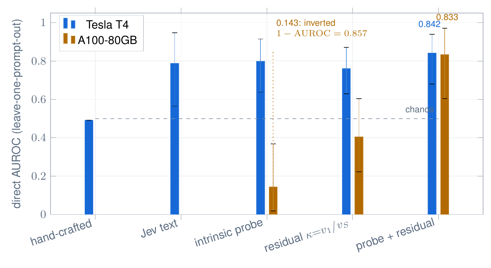
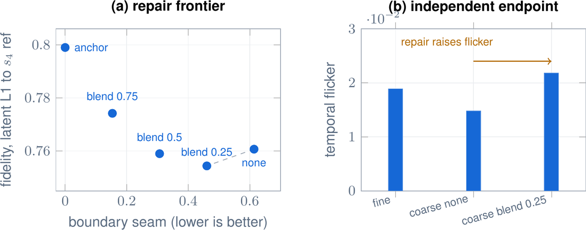
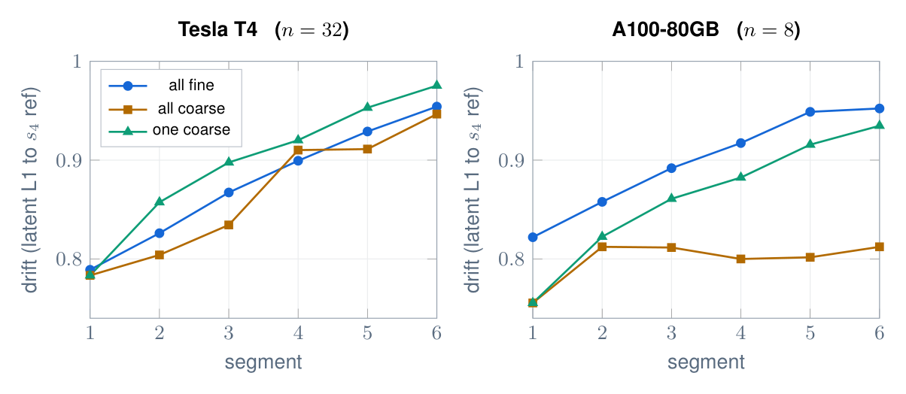
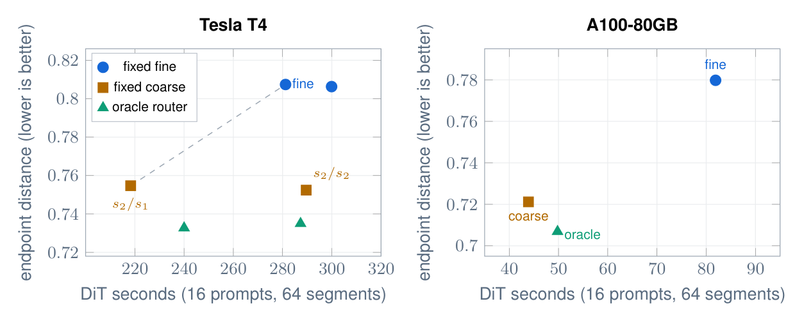

# DDAG — Method (Part 2 of 2)

**Deadline- and Drift-Aware Adaptive Temporal Granularity** for causal video world models — the method
built on the report in [`../jevgag/`](../jevgag/).

[](https://www.kaggle.com/datasets/ajjisan/ddag-experiments)
[](https://www.kaggle.com/datasets/ajjisan/ddag-matched-frames)
[](#hardware)

DDAG turns the report's four preconditions into a **deployable rule**: measure the regime, then choose a
granularity policy that is justified inside that regime. Every claim below is backed by an audited
experiment folder with its own kernel, analysis and result file.

---

## The method in one paragraph

For a segment `t`, DDAG (i) forms an **intrinsic pre-generation probe** from the generator's own prefill
activations, (ii) optionally forms a **convergence residual** `κ = v₁/v_S` from the sampler's step-to-step
update magnitudes, (iii) routes to a cheap or fine mode through a **calibrated gate**, and (iv) applies a
**training-free seam repair** at accepted switches. Whether any of this is *worth using* is decided by the
**regime map**: adaptive granularity pays only when the cheap mode is cheaper **and** worse.


---

## The twelve experiments (reading order)

| # | Folder | Question | Result (verified) |
|---|---|---|---|
| 01 | [`01_intrinsic_probe`](experiments/01_intrinsic_probe) | can the generator predict its own granularity safety? | **yes — direct AUROC 0.798** [0.639, 0.916], no external oracle (hand-crafted 0.491) |
| 02 | [`02_seam_repair`](experiments/02_seam_repair) | can the switch seam be reduced without training? | **yes — a 25 % latent blend cuts the seam 25 %** (0.614 → 0.460) and improves fidelity (0.761 → 0.754) |
| 03 | [`03_closed_loop_evidence`](experiments/03_closed_loop_evidence) | does post-generation evidence add signal? | free evidence alone **0.725**; closed loop 0.690 → **0.737** (CIs overlap; bounded) |
| 04 | [`04_escalation_gate`](experiments/04_escalation_gate) | is a calibrated escalation gate viable? | **boundary** — the cost model, not the signal, binds (0-GPU NO-GO) |
| 05 | [`05_convergence_residual`](experiments/05_convergence_residual) | does a sampler convergence residual verify safety? | T4 **0.760** [0.629, 0.870]; **probe + residual 0.842 / 0.833** (transfers); the reciprocal is **inverted** (0.240) |
| 06 | [`06_drift_propagation`](experiments/06_drift_propagation) | does coarse error propagate? | **yes on T4** — one coarse segment leaves a persistent elevation, significant at **4/5** tail segments |
| 07 | [`07_online_policy`](experiments/07_online_policy) | does routing beat a fixed mode? | **boundary** — on A100 coarse dominates (**−46 %** cost, 43.9 s vs 81.9 s) |
| 08 | [`08_intermediate_band`](experiments/08_intermediate_band) | does routing pay inside the band? | coarse **27 %** cheaper (218.3 s vs 299.9 s); the latent endpoint does not penalise it |
| 09 | [`09_pixel_endpoint`](experiments/09_pixel_endpoint) | does a decoded-pixel endpoint change the verdict? | **no** — coarse is cheaper (0.711×) *and* closer by pixels (0.2511 vs 0.2686) |
| 10 | [`10_jev_critic`](experiments/10_jev_critic) | can a pixel-only Jev critic certify safety from pixels? | **boundary** — chance (**0.497**); context, not the model, is the limit |
| 11 | [`11_flicker_endpoint`](experiments/11_flicker_endpoint) | does the repair trade seam for flicker? | **yes** — the repair raises flicker to 0.0218, above both fine (0.0189) and coarse (0.0148) |
| 12 | [`12_qualitative`](experiments/12_qualitative) | what do the modes actually look like? | all six matched cases rendered in one frame (see Fig. 7 of the paper) |

---

## Key results in numbers

**Signals for coarse-unsafe segments (direct AUROC, leave-one-prompt-out, n = 64 segments per GPU)**

| signal | Tesla T4 | A100-80GB |
|---|---|---|
| hand-crafted context statistics | 0.491 | — |
| Jev text oracle (report) | 0.788 | — |
| **intrinsic prefill probe** (block 11) | **0.798** [0.639, 0.916] | **0.143** [0.018, 0.368] *(inverts)* |
| convergence residual `κ = v₁/v_S` | **0.760** [0.629, 0.870] | 0.404 [0.223, 0.603] |
| reciprocal `v_S/v₁` (the first guess) | 0.240 *(inverted)* | 0.596 |
| **probe + residual** (multi-feature) | **0.842** [0.680, 0.938] | **0.833** [0.605, 0.971] |



**The transfer result is the informative one:** no *single* signal transfers across GPUs (the probe
inverts, 0.798 → 0.143), yet the **multi-feature model does** (0.842 / 0.833).

**Seam repair (T4, 32 matched segments)**

| variant | boundary seam | fidelity | temporal flicker |
|---|---|---|---|
| none | 0.614 | 0.761 | 0.0148 |
| **blend 0.25** | **0.460** (−25 %) | **0.754** (better) | 0.0218 |
| blend 0.50 | 0.307 | 0.759 | — |
| blend 0.75 | 0.153 | 0.774 | — |
| anchor (hard) | 0.000 | 0.799 | — |
| fine (no switch) | 0.215 | 0.807 | 0.0189 |



**Drift propagation (81 frames, 6 segments)**

| GPU | chain | drift trajectory (segments 1 → 6) |
|---|---|---|
| T4 (n = 32) | all fine | 0.789 0.826 0.867 0.899 0.929 0.954 |
| T4 (n = 32) | all coarse | 0.783 0.804 0.834 0.910 0.911 0.947 |
| T4 (n = 32) | one coarse, then fine | 0.783 **0.857 0.898 0.920 0.953 0.975** |
| A100 (n = 8) | all fine | 0.822 0.858 0.892 0.917 0.949 0.952 |
| A100 (n = 8) | all coarse | 0.756 0.812 0.812 **0.800 0.802 0.812** |



**Policies (the regime map, 16 prompts / 64 segments)**

| operating point | policy | DiT total (s) | quality | optimal for the constrained objective |
|---|---|---|---|---|
| T4, `s2/s2` | fixed fine | **281.2** | **0.807** | **yes** |
| T4, `s2/s2` | fixed coarse | 289.6 | 0.752 | no (dearer) |
| T4, `s2/s1` | fixed coarse | **218.3** | **0.755** | **yes** |
| A100, `s2/s2` | fixed coarse | **43.9** | **0.721** | **yes** |
| A100, `s2/s2` | oracle router | 49.8 | 0.707 | no (adds cost) |



**The regime map is empty here:** at every operating point one fixed mode is cost-optimal, so a router
adds nothing. The oracle bound shows the headroom is not merely small but *negative* on cost.

---

## Boundaries (recorded, never hidden)

| Boundary | Resolution / status |
|---|---|
| hand-crafted context statistics do not predict hard segments (0.491, prior report) | intrinsic prefill probe (**0.798**) — **resolved** |
| switching costs a boundary discontinuity | training-free repair (**−25 %**) — **resolved** |
| coarse error propagates on T4 | quantified: linear, not compounding — **characterised** |
| signals do **not** transfer across GPUs (0.798 → 0.143) | signals are regime properties — **open** |
| a pixel-only critic is at chance (0.497, this work) | critics need context, not pixels — **open** |
| the repair raises interior flicker | multi-endpoint protocol required — **open** |

---

## Layout

```
ddag/
├─ experiments/  01_intrinsic_probe … 12_qualitative   (kernel + results + notes per experiment)
├─ analysis/     shared analysis scripts (one per experiment)
├─ results/      consolidated machine-readable results (+ signal_combined.json)
└─ compute/      Colab A100 runners
```

## Reproduce (0 GPU analyses)

```bash
cd ddag
python analysis/signal_combined.py  --features results/features_t4.npz        --out results
python analysis/crv_analysis.py     --features results/features_t4.npz        --out results
python analysis/drift_analysis.py   --meas     results/drift_t4_n32.npz       --out results/t4_n32
python analysis/online_policy.py    --features results/features_online_a100.npz --out results/online_a100
python analysis/jcd_analysis.py     --meas     results/jcd_t4.npz             --out results
python analysis/flicker_analysis.py --meas     results/flicker_t4.npz         --out results
```

## Hardware

Tesla T4 (Kaggle) and NVIDIA A100-SXM4-80GB (Colab). Backbone: **Causal-rCM Wan2.1-T2V-1.3B**
(`ed3cb14`). Oracle: **Jev `jev-1.14.0`**.

## Data

| Artifact | Where |
|---|---|
| All twelve experiments (results + figures) | Kaggle: [`ajjisan/ddag-experiments`](https://www.kaggle.com/datasets/ajjisan/ddag-experiments) |
| Matched decoded frames (54 frames) + grid | Kaggle: [`ajjisan/ddag-matched-frames`](https://www.kaggle.com/datasets/ajjisan/ddag-matched-frames) |
| Consolidated results in-repo | [`results/`](results/) |

## Citation

```bibtex
@software{hossen2026ddag,
  title  = {DDAG: Deadline- and Drift-Aware Adaptive Temporal Granularity for Causal Video World Models},
  author = {Hossen, Md Jisan},
  year   = {2026},
  url    = {https://github.com/j1s4nn/JevGAG/tree/main/ddag}
}
```
