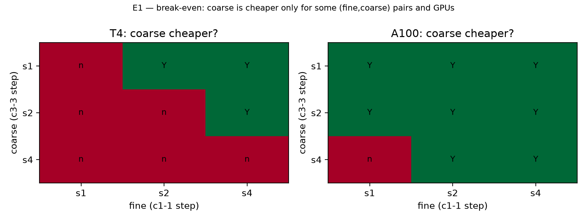
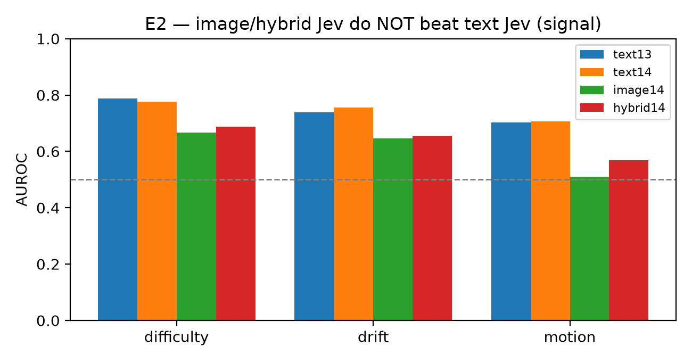
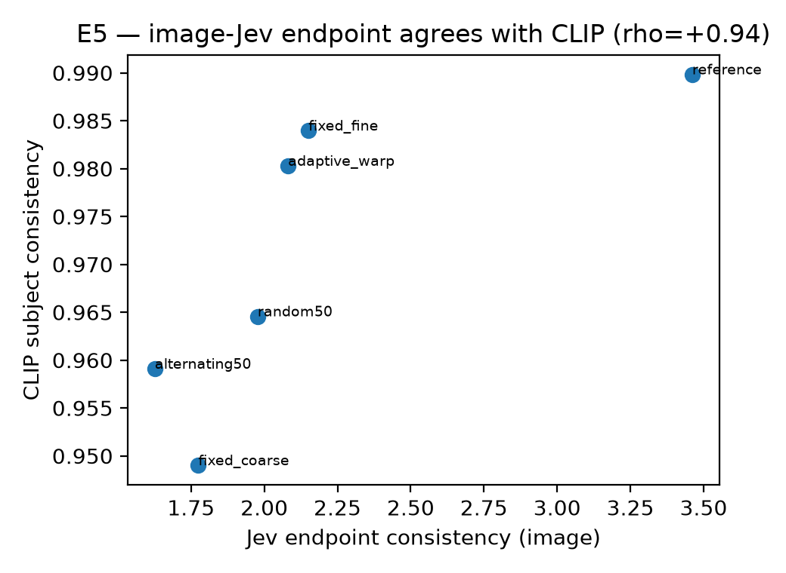
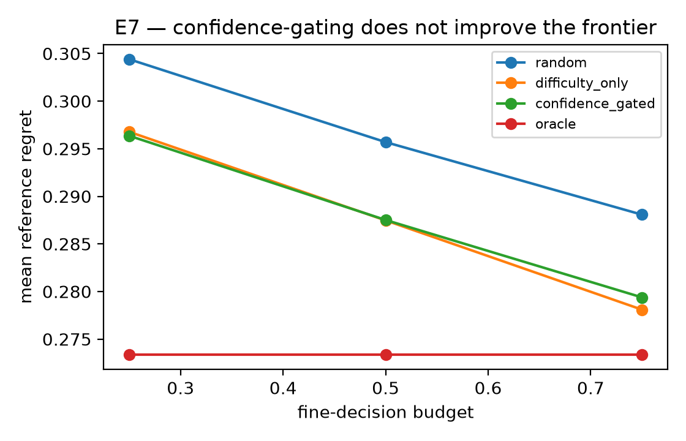
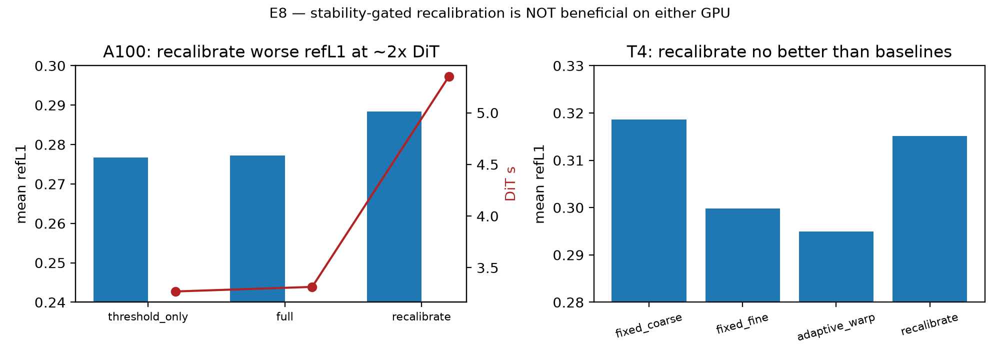

# JevGAG — Report (Part 1 of 2)

**Jev-Grounded Adaptive Temporal Granularity for Causal Video Generation: An Audit of the Cost, Signal
and Endpoint Preconditions**

[](report/REPORT.md)
[](report/main.pdf)
[](results/e9_audit/claim_audit.md)
[](https://www.kaggle.com/datasets/ajjisan/jevgag-results)

An empirical audit of the four preconditions that any **adaptive temporal granularity** scheme for causal
video generation silently assumes. This is the foundation; the method built on it lives in
[`../ddag/`](../ddag/).

> **Paper:** *Regime-Aware Temporal Granularity for Causal Video World Models: When Does Adaptivity Pay?* —
> Md Jisan Hossen, 2026. **https://doi.org/10.5281/zenodo.23693517** (this report is Part 1 of that paper's
> programme).

> **Read the report:** [Markdown](report/REPORT.md) · [PDF](report/main.pdf) · [LaTeX](report/main.tex)

---

## Preconditions and what the report finds

| Precondition | Question | Finding |
|---|---|---|
| **P1 — cost** | is the cheap mode genuinely faster on *this* GPU at *this* schedule? | **hardware-conditional.** The same pair (fine `s2`, coarse `s2`) has per-forward ratio **2.97** on T4 (break-even 2.68 → coarse dearer) and **1.74** on A100 (→ coarse cheaper) |
| **P2 — signal** | does a **pre-generation** quantity predict "coarse-unsafe"? | **Jev text works (0.788 AUROC); image does not (0.667).** Hand-crafted context statistics fail (0.491 in the prior study) |
| **P3 — endpoint** | is quality certified by a measure **independent** of the compared modes? | the internal reference flips between GPUs; an **image-grounded Jev endpoint** agrees with CLIP subject consistency at **ρ = +1.000** |
| **P4 — calibration** | is the oracle's confidence informative enough to gate on? | **no.** Confidence-gated routing is neutral (\|Δ\| ≤ 0.0013 at every budget) |

---

## Headline results (all values verified against stored artifacts)

| E | Result | Key numbers |
|---|---|---|
| **E1** break-even | hardware- and operating-point-conditional | T4 `c3-3 s4` **never** cheaper; A100 `c3-3 s1` cheaper than all fine modes |
| **E2** signal | image-Jev does **not** beat text-Jev | ΔAUROC difficulty **−0.110**, drift **−0.108**, motion **−0.195** (P = **0.006**) |
| **E3** operating point | the adaptive verdict flips with the coarse step alone | expensive coarse → **92 %** fine; cheap coarse → **21 %** fine and 2.55 s vs 3.95 s |
| **E4** controller + seam | recovery+hysteresis cut switches; a seam exists | switches **0.50 → 0.38** (T4), **0.50 → 0.42** (A100); seam ratio **1.18 / 1.98** |
| **E5** endpoint | image-Jev is a validated independent endpoint | **ρ = +1.000** (same-subject), **+0.943** (consistency), 48 videos / 6 policies |
| **E6** T4 boundary | the T4 negative is an operating-point boundary | coarse `s1` vs fine `s1` saves **−4.57 s** (slower) |
| **E7** confidence gating | neutral | \|Δ\| ≤ **0.0013** vs difficulty-only at every budget |
| **E8** recalibration | does not help on either GPU | A100 refL1 **+0.0112** at **+2.04 s**; T4 **+0.0202** at **+12.73 s** |
| **E9** audit | every headline number re-derived | **18/18 PASS** |

---

## Figures

| | |
|---|---|
|  |  |
| **E1** — coarse is cheaper only where the measured per-forward ratio falls below the schedule break-even, and the same pair sits on opposite sides on the two GPUs. | **E2** — image- and hybrid-grounded Jev do not beat text-grounded Jev as a routing signal. |
|  |  |
| **E5** — the image-grounded Jev endpoint agrees with CLIP subject consistency at ρ = +1.000. | **E7** — confidence gating is indistinguishable from difficulty-only routing. |
|  | |
| **E8** — recalibration raises the endpoint distance at higher cost on both GPUs. | |

---

## Layout

```
jevgag/
├─ report/      REPORT.md (GitHub-readable) · main.tex · main.pdf · references.bib
├─ code/        one audit script per experiment (e1 … e9) + figure generation
├─ results/     audited result files + one Markdown table per experiment
├─ figures/     publication figures (E1, E2, E5, E7, E8)
└─ compute/     kernel / notebook definitions (colab/, jobs/)
```

## Reproduce (0 GPU)

```bash
cd jevgag
python code/e1_breakeven.py
python code/e2_image_signal.py && python code/e2_text14.py && python code/e2_hybrid.py && python code/e2_audit.py
python code/e3_online_matched.py
python code/e4_rq3_seam.py
python code/e5_endpoint.py && python code/e5_audit.py
python code/e6_t4_boundary.py
python code/e7_confidence_gate.py
python code/e9_claim_audit.py
```

Backbone: **Causal-rCM Wan2.1-T2V-1.3B** (`ed3cb14`) · GPUs: **Tesla T4** and **A100-SXM4-80GB** ·
Oracle: **Jev `jev-1.14.0`**.

## Data

| Artifact | Where |
|---|---|
| Audited result files | [`results/`](results/) — one folder per experiment with a Markdown table and a JSON |
| Claim-to-artifact audit | [`results/e9_audit/claim_audit.json`](results/e9_audit/claim_audit.json) — 18/18 PASS |
| Public bundle | Kaggle: [`ajjisan/jevgag-results`](https://www.kaggle.com/datasets/ajjisan/jevgag-results) · [`ajjisan/jevgag-selfaware-dit`](https://www.kaggle.com/datasets/ajjisan/jevgag-selfaware-dit) · [`ajjisan/jevgag-seamcontrol`](https://www.kaggle.com/datasets/ajjisan/jevgag-seamcontrol) · [`ajjisan/jevgag-closedloop-gran`](https://www.kaggle.com/datasets/ajjisan/jevgag-closedloop-gran) |
| Videos | Kaggle: [`ajjisan/jev-adaptive-granularity-videos`](https://www.kaggle.com/datasets/ajjisan/jev-adaptive-granularity-videos) |

## Prior work

Hossen Md Jisan. *Jev-Routed Temporal Granularity with Recovery and Hysteresis for Causal Video
Generation.* Preprint, 2026. **https://doi.org/10.5281/zenodo.23395414**

## Citation

```bibtex
@misc{hossen2026jevgagreport,
  title        = {Jev-Grounded Adaptive Temporal Granularity for Causal Video Generation: An Audit of the Cost, Signal and Endpoint Preconditions},
  author       = {Hossen, Md Jisan},
  year         = {2026},
  howpublished = {Report},
  url          = {https://github.com/j1s4nn/JevGAG/tree/main/jevgag}
}
```
